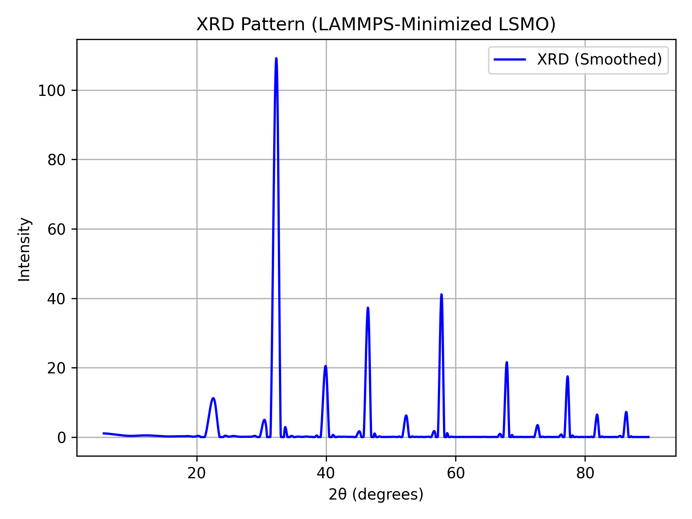

# LSMO Superconductor Synthesis Simulation

This project simulates the synthesis of the perovskite material La𝕛𝕥𝕠𝕜𝕣O₃ (LSMO) using molecular dynamics (LAMMPS) and analyzes the output structure using X-ray diffraction (XRD).

## Features

* LSMO structure generation with La/Sr doping
* LAMMPS simulation with structure minimization
* XRD simulation and smoothed plot generation
* All plots saved as `.png` images for publishing

## Dependencies

Install all Python dependencies:

```bash
pip install numpy matplotlib pymatgen scipy
```

You also need **LAMMPS** with Python bindings installed.

## File Structure

```
lsmo_simulation/
├── lsmo.py                 # Main Python simulation and analysis script
├── README.md               # Project description and usage
├── LICENSE                 # License for open source usage (MIT)
├── .gitignore              # Files to ignore in version control
├── lsmo.lmpdat             # Initial LAMMPS structure data (auto-generated)
├── lsmo_minimized.lmpdat   # Minimized structure output from LAMMPS
├── in.lsmo                 # LAMMPS input script
├── xrd_lammps.png          # Saved XRD plot
```

## Running the Simulation

1. Clone the repository:

```bash
git clone https://github.com/Pratikbhanuse/LSMO-Synthesis-Computationally.git lsmo_simulation
cd lsmo_simulation
```

2. Install Python dependencies:

```bash
pip install -r requirements.txt
```

3. Run the simulation:

```bash
python lsmo.py
```

4. LAMMPS must be installed and available in your environment. If needed, modify the `run_lammps()` function in `lsmo.py` to match your LAMMPS setup.

5. The output plot `xrd_smoothed.png` will be saved in the current directory.

## Example Output



## License

MIT License. See `LICENSE` file.

---

For questions, suggestions, or contributions, feel free to open an issue or pull request.
